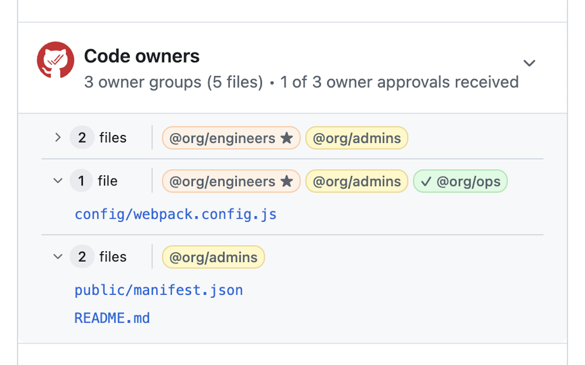
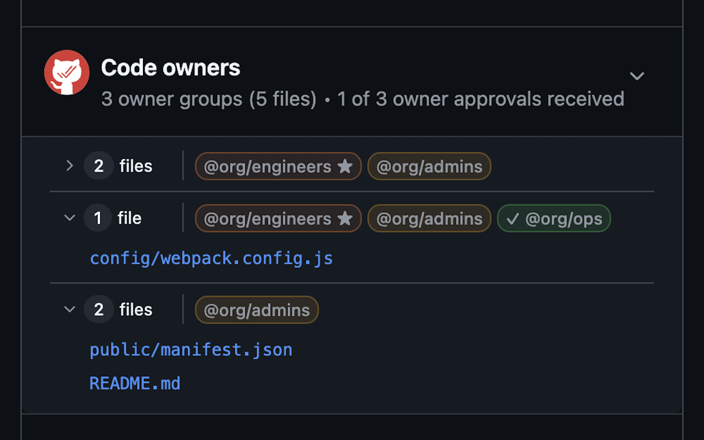
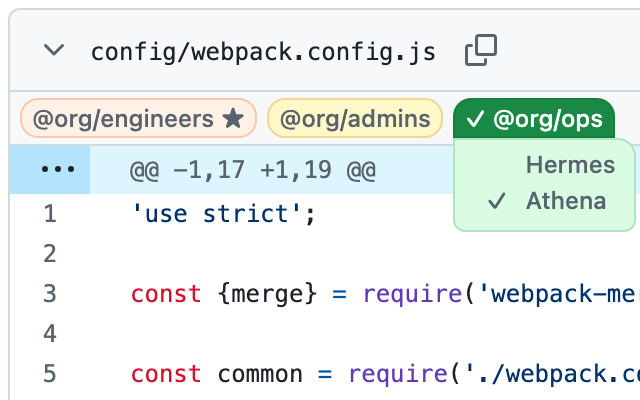
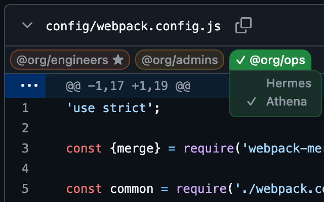

#  GitHub Codeowners

GitHub Codeowners Browser Extension






## Features

Decorate GitHub PR pages with code ownership and approval status \
Does not require a GitHub access token

**Decorations:**
- Code owners section on the PR conversation page showing *owner labels* for who needs to approve groups of files
- *Owner labels* in file headers on the files tab and compare view
- Icons indicating role of commenters
  -  PR author
  -  code owner
  -  other contributor

***Owner Labels:***

- Hovering shows a drawer with the members of that team
- Clicking expands that owner's files and collapses the others
- Appearance indicates approval status and your team membership
  - 🔴 **Red**: Pending your approval
  - 🟡 **Yellow**: Pending approval from others
  - 🟢 **Green**: Approved
  - ★ **Star**: Your team
  - ✓ **Checkmark**: Approved

See [CHANGELOG.md](CHANGELOG.md) for version history.

## Install

### Chrome

Install from [Chrome Store](https://chromewebstore.google.com/detail/GitHub%20Codeowners/bleicmjinodghcdonmnfgmjmhgnhppbk)

### Firefox

Install from [Firefox Add-ons](https://addons.mozilla.org/en-US/firefox/addon/github-codeowners/)

## VSCode extension

An add-on for the [GitHub Pull Requests](https://marketplace.visualstudio.com/items?itemName=GitHub.vscode-pull-request-github) extension shows the same code owner information in VSCode:

- Badges on the pull request's changed files: ★ needs your approval, ◐ waiting on other owners, ✓ approved. Hover a file to see its owners and their team members.
- A "Code Owners" view in the Pull Request panel that groups files by owner, with the same approval summary as the Code owners section on GitHub.
- Click a team or person to open every file they can approve in one multi-file diff.

It is not on the Visual Studio Marketplace yet. To build and install it, see [vscode/README.md](vscode/README.md).

## Building

> [!TIP]
> If you don't already have Node.js and npm, you'll need to [install](https://docs.npmjs.com/downloading-and-installing-node-js-and-npm) them first.

```
npm install
npm run build
```

The extension will be in the `build/` directory.

## Privacy

All data collected by this extension is kept and used only within the browser; it is not transmitted out of the extension.

The data collected includes:
* The username of the logged-in GitHub user is read from the page metadata.
* The usernames and team names mentioned in the `CODEOWNERS` file are collected and cached in memory.
* Team member usernames for teams mentioned in `CODEOWNERS` are collected and cached in memory.

> [!NOTE]
> Any GitHub access token that was previously stored by v0.1.0 of the extension will be deleted from storage.

The VSCode extension reads the same data from the GitHub API, with the GitHub account that you sign in to in VSCode. It sends requests only to GitHub, and keeps the data in memory only.

---

This project was bootstrapped with [Chrome Extension CLI](https://github.com/dutiyesh/chrome-extension-cli)

